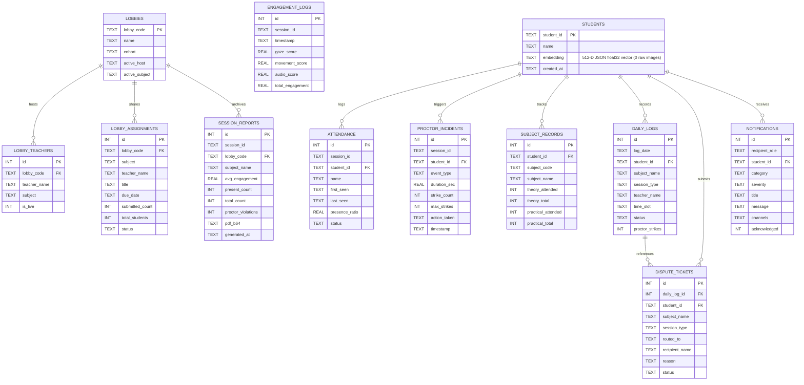

# AttendAI — Technical Architecture & Security Specification

## 1. Architectural Overview

AttendAI follows a **local-first, modular edge architecture** designed to operate with zero external cloud dependencies for biometric inference, audio voice activity detection, database persistence, and pedagogical LLM reasoning.

| Layer | Technology | Responsibility |
| :--- | :--- | :--- |
| **Presentation & Role Shell** | Streamlit + Modular CSS (`modules/styles.py`) + Embedded JS Focus Guard | Role-aware UI (`Instructor / Mentor`, `Student`, `Parent / Guardian`), real browser `visibilitychange`/`blur` proctoring, and live Plotly telemetry. |
| **Biometric Identity Layer** | InsightFace (`buffalo_sc`, ONNX Runtime CPU) | Extracts 512-D L2-normalized facial embeddings transiently in RAM; verifies identity via cosine similarity ($\tau_{\text{sim}} = 0.45$). |
| **Engagement Signal Layer** | OpenCV Haar Cascades + WebRTC VAD (`sounddevice`) | Computes rolling visual gaze alignment, centroid motion/inactivity timers, and binary vocal activity ratios without recording audio clips. |
| **Agentic & Reporting Layer** | Ollama (`llama3.2:3b`) + Rule Fallback + Pure-Python PDF 1.4 Compiler | Generates categorized pedagogical recommendations (`Engagement`, `Pacing`, `Comprehension`, `Participation`) and auto-compiles branded PDF session reports on session termination. |
| **Local Storage Layer** | SQLite (`data/classroom.db`) | ACID-compliant local storage for vectors, sustained attendance, proctoring logs, lobbies, Theory/Practical ledgers, dispute tickets, and notifications. |

---

## 2. Database Entity-Relationship Schema (`data/classroom.db`)

---

## 3. Multimodal Fusion & Scoring Specifications

| Signal Channel | Weight | Extraction Method | Edge Failure Behavior |
| :--- | :---: | :--- | :--- |
| **Visual Gaze Alignment $G(t)$** | `50%` | OpenCV frontal face + upper-ROI eye cascade detection (`2 eyes = 95%`, `1 eye = 75%`, `face only = 55%`). | Scores `0%` when no face is detected; smoothed via 30-frame rolling `deque`. |
| **Posture & Motion $M(t)$** | `25%` | Inter-frame Euclidean displacement of primary face centroid + inactivity timer (`>15s` static triggers penalty to `35%`). | Prevents passive screen-staring or static photo spoofing from scoring artificially high. |
| **Vocal Interaction $A(t)$** | `25%` | WebRTC VAD (aggressiveness level `2`) over 30 ms PCM frames at 16 kHz. | Falls back gracefully to a neutral `50.0%` baseline when microphone hardware is unavailable (e.g., Linux cloud containers). |

### Internal Attendance Grade Slabs
| Cumulative / Subject % | Internal Grade | Eligibility Status |
| :---: | :---: | :--- |
| $\ge 90.0\%$ | `A+ (5/5 Marks)` | Optimal |
| $85.0\% - 89.9\%$ | `A (4/5 Marks)` | Optimal |
| $75.0\% - 84.9\%$ | `B (3/5 Marks)` | Watch |
| $< 75.0\%$ | `Detained (0/5)` | **At-Risk (Dual Student + Parent Warning Triggered)** |

---

## 4. Privacy & Student Safety Threat Model

| Threat Vector | Architectural Mitigation in AttendAI |
| :--- | :--- |
| **Biometric Photo Leakage** | Raw enrollment frames and live camera buffers remain strictly in volatile RAM and are never written to disk. Only irreversible 512-D L2-normalized float vectors are stored in SQLite. |
| **Cloud Surveillance / Third-Party APIs** |